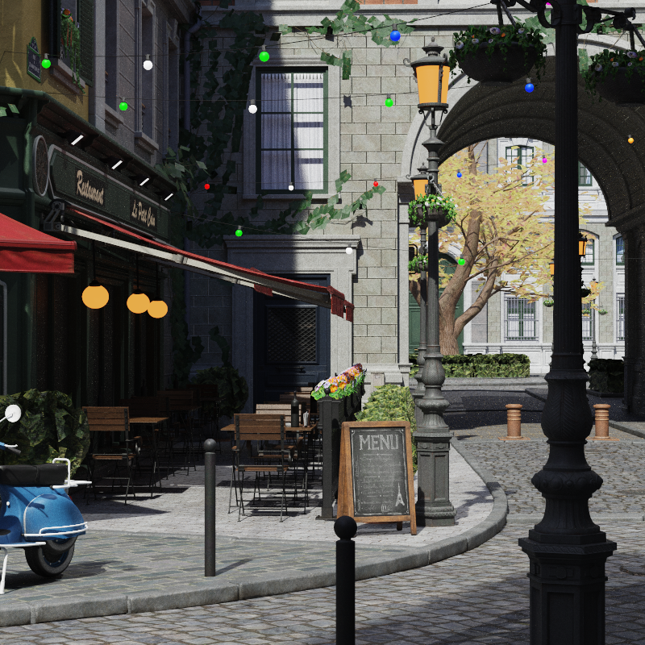
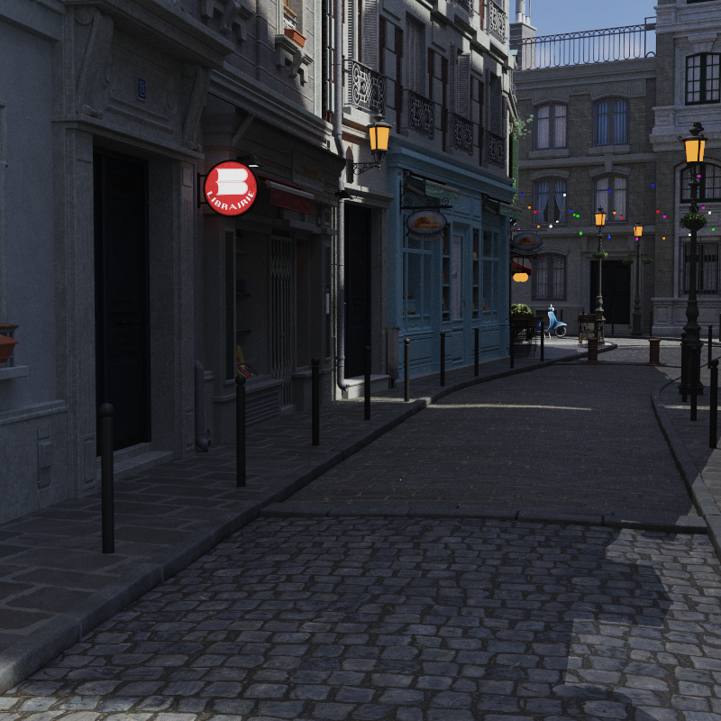
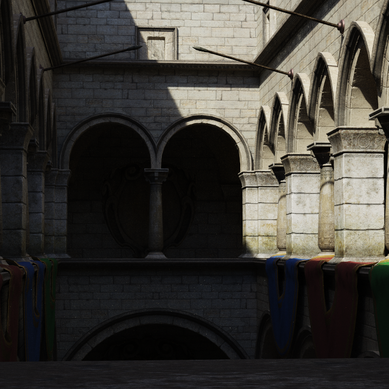
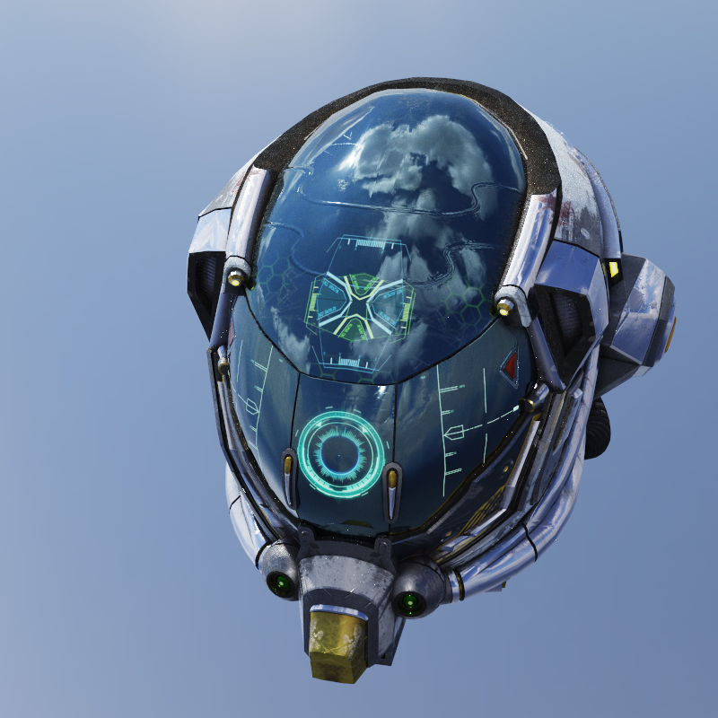
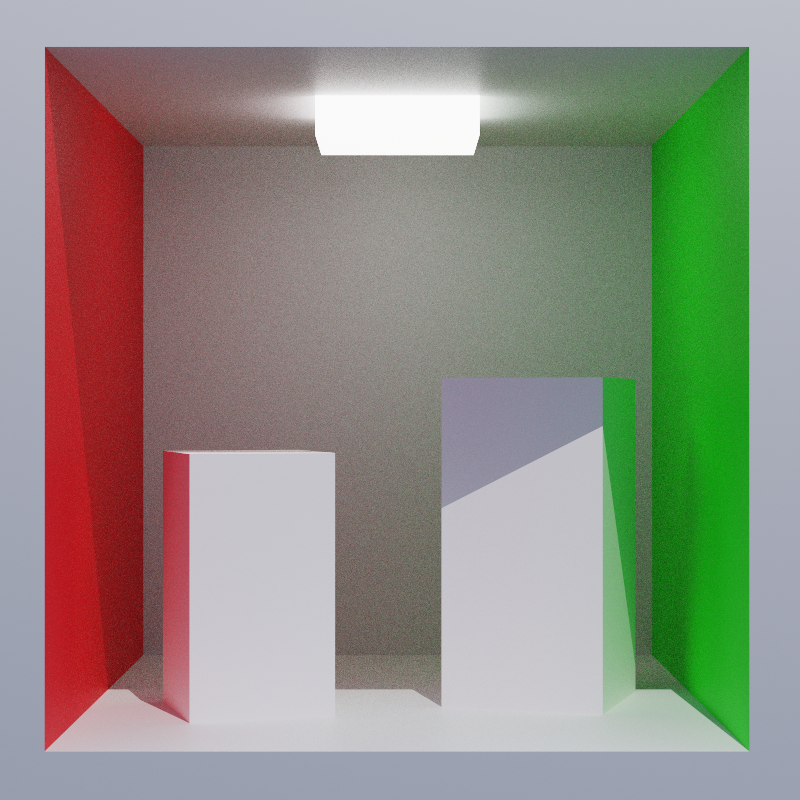

# rnpt — Rust Neural Path Tracer

**rnpt** is a CPU path tracer built as a controlled sandbox for global illumination research. GI is where the hard problems are, and a GPU adds its own layer of complexity on top of them: rnpt keeps the algorithms readable and debuggable, fast enough to iterate on real scenes, so ideas can be validated here before being ported to the GPU. It picks up roughly where the *Ray Tracing in One Weekend* series leaves off: an 8-wide SIMD BVH, MIS with GGX, HDRI importance sampling, and an online-trained neural radiance cache (NIRC).

Every major system — BVH, BRDF, MIS, and the neural cache itself — is implemented from scratch with correctness and clarity as first-class concerns, and serves as an educational reference for anyone curious about these topics.

Developed in collaboration with Claude (Anthropic) as a coding assistant; design, experiments and validation are mine.

<p align="center"></p>

| | |
|---|---|
|  |  |
|  |  |

<sub>All images rendered by rnpt on CPU (MIS, 8 000 rays per pixel, 800×800, ACES tonemapping).</sub>

## Goals

- **Algorithm prototyping** — validate rendering research ideas (ReSTIR, neural caches, MIS variants) on CPU where iteration is fast and debugging is straightforward, then port the validated design to GPU.
- **Educational reference** — each subsystem is self-contained and documented. The BVH in particular is production-quality and serves as a study case for SIMD-accelerated tree traversal.
- **Measured, not eyeballed** — every approximation is compared against a ground truth: renders against a converged unbiased reference at equal ray budget, BVH versions against brute-force intersection. A faster wrong answer does not count.
- **Real-world scenes** — glTF 2.0 import with PBR materials, punctual lights, HDRI environments, transmission/IOR/volume extensions. Tested on Cornell Box, Bistro exterior, and others.

## Features

### Rendering

| Feature | Details |
|---|---|
| Integrator | Unbiased path tracing, Russian roulette termination (PBRT-style, unbiased) |
| Sampling strategies | BRDF-only · NEE-only · MIS (balance heuristic) · Direct-only · NIRC |
| BRDF | Lambertian diffuse + GGX Cook-Torrance specular (metallic-roughness) |
| Glass | Thin/thick dielectric, Schlick Fresnel, GGX microfacet sampling |
| Area lights | Emissive mesh triangles |
| Punctual lights | Point, spot and directional (`KHR_lights_punctual`) |
| Light selection | One light per shading point, alias table weighted by estimated power, selection pdf folded into MIS |
| Environment | HDRI equirectangular, 2D piecewise-constant importance sampling |

### BVH

8-wide BVH (BVH-8) built with SAH (16-bin sweep). Nodes store 8 child AABBs in SoA layout with `#[repr(C, align(32))]` for AVX2-friendly loads. Triangle intersection uses Möller–Trumbore with `wide::f32x8` fused multiply-add — 8 triangles tested in parallel per SIMD lane. Front-to-back traversal: children are sorted by entry distance, and subtrees behind the closest hit are pruned.

The BVH lives in its own crate (`rnpt-bvh`) and can be used independently.

### NIRC — Neural Incident Radiance Cache

An online-trained neural cache that replaces indirect path tracing bounces with a network prediction, trading a small bias for faster convergence. The network is deliberately naive: the point is to see how far the simplest possible cache goes.

<details>
<summary>Architecture and training</summary>

- **Architecture**: 4-layer MLP, hidden dim 16, ReLU activations. ~755 parameters, <3 KB — fits entirely in L1 cache.
- **Encoding**: raw position normalized to the scene bounds (3 features) + NeRF sinusoidal for direction (sin/cos at one frequency, 6 features) → `INPUT_DIM = 9`.
- **Training**: Adam optimizer, log-space MSE loss for HDR balance, EMA-smoothed inference snapshot published to workers lock-free. Targets are single noisy path-traced samples: the network learns their expectation, and its small capacity pools neighbouring samples — denoising for free, paid for by spatial smoothing (the bias).
- **Sample collection**: Lock-free ring buffer (131 072 entries). On average one rendered pixel in 64, drawn at random, triggers a dedicated MIS path; all bounce-level radiances are pushed as training targets.
- **Inference**: `gemv`-based forward pass (no weight matrix copies), alternating activation buffers. Backward pass uses `gemv_tr` to transpose-multiply without materializing the transpose.
- **Fair comparison**: strategies are compared at an equal per-pixel ray budget, counting every ray — closest hit, shadow, and the network's training paths.

</details>

### Image comparison

`rnpt-compare` answers one question: at the same cost, which strategy gets closer to the truth, and where does it go wrong?

- **Equal budget**: every strategy gets the same number of rays per pixel — closest hit, shadow and training rays all count — so a cheaper path buys more samples instead of hiding its cost.
- **Reference**: MIS, unbiased, at 20 000 rays per pixel by default. References are cached per scene, view and resolution, and reused across runs and variants (`--tag`).
- **Metrics** (via `tools/imgcmp`, on the HDR output):
  - *RelMSE* — mean of (render − ref)² / (ref² + 0.01), so dark and bright regions weigh alike;
  - *bias* — mean signed relative error, which noise averages out and a systematic error does not;
  - *efficiency* — 1 / (RelMSE × cost), per ray and per second, relative to the first strategy.
- **Maps**: per-pixel relative error (log scale), and a local bias map — relative error averaged over a Gaussian (σ = 6 px), so noise cancels out and only structured error remains, blue where the render is too dark, red where it is too bright.
- **Modes**: full image, or *indirect only* (light after at least two diffuse or glossy bounces; glass does not count), where the strategies actually differ.
- **Report**: one HTML page per run, renders, maps and table side by side.


Workers run on all available cores, with 32×32 pixel tiles dealt round-robin so every region of the image progresses at the same pace. The pixel buffer is shared lock-free (workers write disjoint tiles; the GUI reads concurrently for progressive display). NIRC network hot-swap happens without restarting a render pass.

## Crate structure

```
rnpt/
├── crates/
│   ├── rnpt/          # Core library — path tracing, materials, NIRC, scene model
│   ├── rnpt-bvh/      # Standalone BVH — SAH builder, 8-wide SIMD traversal
│   └── rnpt-gui/      # eframe/egui GUI, plus rnpt-render and rnpt-compare (headless)
├── tools/
│   ├── imgcmp/        # HDR image comparison: RelMSE, error and bias maps
│   ├── bvh-stats/     # counts BVH operations per ray (nodes, chunks), vs the SAH prediction
│   └── history-bench/ # replays the BVH's performance across the git history
└── assets/            # glTF scenes, HDRI environment maps
```

## Scene format

glTF 2.0 (`.glb` / `.gltf`) via the `gltf` crate. Supported extensions:

- `KHR_lights_punctual`
- `KHR_materials_emissive_strength`
- `KHR_materials_transmission`
- `KHR_materials_ior`
- `KHR_materials_volume`

HDRI environment maps (`.hdr`) loaded via the `image` crate.

## Usage

### Adding scenes and environments

Drop `.glb` or `.gltf` files into the `assets/` directory. Drop `.hdr` files there for HDRI environments. Both are picked up automatically on next launch and selectable from the GUI side panel — no configuration needed.

### Post-processing

The **Post-Processing** panel exposes:

- **Exposure** — linear pre-tonemapping multiplier (0.1 – 10×)
- **Tonemapper** — Reinhard (per-channel) or ACES (Narkowicz filmic fit), both followed by gamma 2.2

### NIRC directional probe

**Ctrl+click** on any surface point while NIRC is active shows what the network has learned there: a small ball resting on the surface, seen from the camera, each point lit by the radiance the network predicts from the direction it faces. A checkbox shows the other half of the ball; gray marks directions below the surface, a yellow cross the surface normal.

The probe is a pure forward pass, so it updates live while the network trains: you can watch it learn the sun direction, colour bleeding from nearby walls, or the sky.

### Rendering strategies

The **Render** panel lets you switch sampling strategy at any time without restarting:

| Strategy | Description |
|---|---|
| MIS | Multiple importance sampling (NEE + BRDF), unbiased reference |
| BRDF | Pure BRDF sampling, no direct light connection |
| NEE | Next-event estimation only |
| Direct | Direct illumination only (one bounce) |
| NIRC | Indirect bounces replaced by the neural cache prediction |

The panel also sets a **per-pixel ray budget** (every ray counts, training rays included) and an **indirect only** mode that keeps only light that bounced at least twice — where the strategies actually differ.

### Headless rendering and comparison

```bash
# render a scene saved from the GUI (Save image writes .png, .hdr and a .json of the settings)
cargo run --release -p rnpt-gui --bin rnpt-render -- --settings renders/my_view.json --strategy nirc --rays 1000
# compare strategies at equal ray budget against a MIS reference; writes an HTML report
cargo build --release --manifest-path tools/imgcmp/Cargo.toml   # error and bias maps used by rnpt-compare
cargo run --release -p rnpt-gui --bin rnpt-compare -- --settings renders/my_view.json --strategies mis,nirc --modes full,indirect
```

## Building

```bash
cargo build --release
cargo run --release -p rnpt-gui
```

Requires Rust 1.85 or later (edition 2024). AVX2 is detected and used automatically at runtime via the `wide` crate; no special `RUSTFLAGS` are needed.

## Testing

```bash
cargo test -p rnpt      # unit tests (BRDF, MIS, NIRC, BVH wrapper)
cargo test -p rnpt-bvh  # geometric BVH integration tests
```

## GUI controls

| Input | Action |
|---|---|
| Left drag | Orbit camera |
| Right drag | Pan |
| Scroll | Zoom |
| Ctrl+click | Place NIRC directional probe at surface point |
| R | Reset render |

## License

GPL-3.0-only — see [LICENSE](LICENSE).
